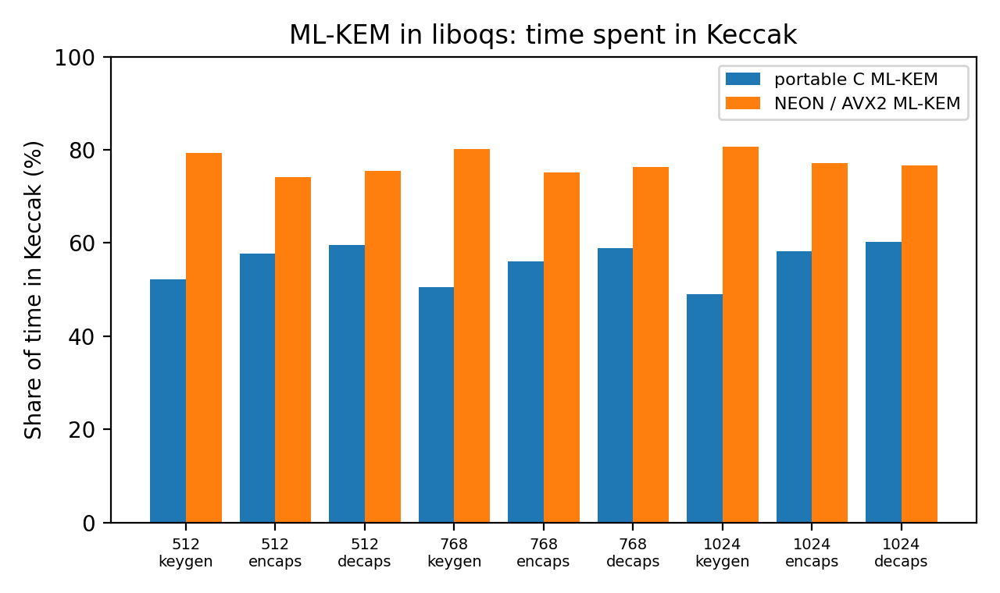

# How much of ML-KEM is Keccak? Profiling liboqs

Post-quantum key exchange (ML-KEM, FIPS 203) leans heavily on Keccak, the permutation behind SHA-3 and SHAKE. Before adding a SHA-3 hardware accelerator to a chip, the first question is how much time Keccak actually takes: if a share *s* of the time is Keccak, a free Keccak speeds ML-KEM up by at most 1/(1-*s*) (Amdahl's law).

This repository measures that share in [liboqs](https://github.com/open-quantum-safe/liboqs) 0.16.0, for ML-KEM-512, 768 and 1024, in two builds:

- **portable**: ML-KEM and Keccak both in portable C;
- **optimised**: ML-KEM arithmetic in NEON (this machine), Keccak unchanged.



## Result (Apple M4 Pro, macOS, Apple clang 17)

**Once the arithmetic is vectorised, Keccak is three quarters of ML-KEM.** For one ML-KEM-768 key exchange (keygen + encaps + decaps):

| | Time | Keccak share | Max gain from a free Keccak |
|---|---|---|---|
| Portable C | 36.6 us | 55% | 2.2x |
| NEON arithmetic | 26.0 us | 77% | 4.4x |

NEON makes the exchange 1.41x faster, but only by shrinking the non-Keccak part: Keccak time stays at about 20.5 us in both builds, so its share rises from 55% to 77%. The more the rest of ML-KEM is optimised, the more a SHA-3 accelerator matters.

Each ML-KEM-768 operation makes about 22 separate Keccak calls (9 to 12 for ML-KEM-512, 28 to 30 for ML-KEM-1024). An accelerator's real gain will therefore depend on its per-call setup cost, not only on its raw permutation speed.

Per operation (us, median of 7 rounds of 1,000 operations):

| Algorithm | Operation | Portable | Keccak share | NEON | Keccak share | Amdahl bound (NEON) |
|---|---|---|---|---|---|---|
| ML-KEM-512 | keygen | 7.7 | 52% | 5.7 | 79% | 4.8x |
| ML-KEM-512 | encaps | 7.6 | 58% | 5.3 | 74% | 3.9x |
| ML-KEM-512 | decaps | 8.8 | 60% | 6.3 | 76% | 4.1x |
| ML-KEM-768 | keygen | 12.8 | 50% | 7.9 | 80% | 5.0x |
| ML-KEM-768 | encaps | 11.1 | 56% | 8.3 | 75% | 4.0x |
| ML-KEM-768 | decaps | 12.7 | 59% | 9.7 | 76% | 4.2x |
| ML-KEM-1024 | keygen | 19.6 | 49% | 11.8 | 81% | 5.2x |
| ML-KEM-1024 | encaps | 16.3 | 58% | 12.9 | 77% | 4.4x |
| ML-KEM-1024 | decaps | 18.8 | 60% | 15.0 | 77% | 4.3x |

Raw data: `results/portable.csv`, `results/optimised.csv`, machine details in `results/system.txt`.

## Method

liboqs sends every SHA-3 and SHAKE call through two tables of function pointers (`OQS_SHA3_set_callbacks`, `OQS_SHA3_x4_set_callbacks`). `bench_mlkem.c` copies liboqs' own default tables, wraps all 53 entries with a nanosecond timer, and installs the wrapped tables. Nested calls are counted once. For each algorithm and operation it alternates rounds with and without the timers, so it reports both the true time per operation and the time inside Keccak, plus the timer overhead (0 to 4% here). Before timing, it checks 100 full key exchanges in each mode and stops if any shared secrets differ.

```
brew install cmake ninja          # plus Xcode command line tools
bash run_benchmark.sh             # builds liboqs twice, runs both, writes results/
```

## Limits

- A laptop core is not a microcontroller. On a Cortex-M class device the split between Keccak and arithmetic will differ, and the number to measure there is the same share.
- The Amdahl figure is an upper bound: it assumes Keccak costs nothing. A real accelerator has setup and data-transfer costs on each of the ~22 calls.
- "Keccak time" is time inside liboqs' SHA-3 API, which includes absorbing and squeezing, not only the permutation.
- On ARM, liboqs 0.16.0 runs Keccak in portable C and the 4-way SHAKE serially; on x86 with AVX2 the shares will be lower.
- Timer resolution on Apple silicon is about 42 ns; the medians over 1,000 operations average that out.

Pablo González Lázaro, MSc Quantum Information, Sorbonne Université.
